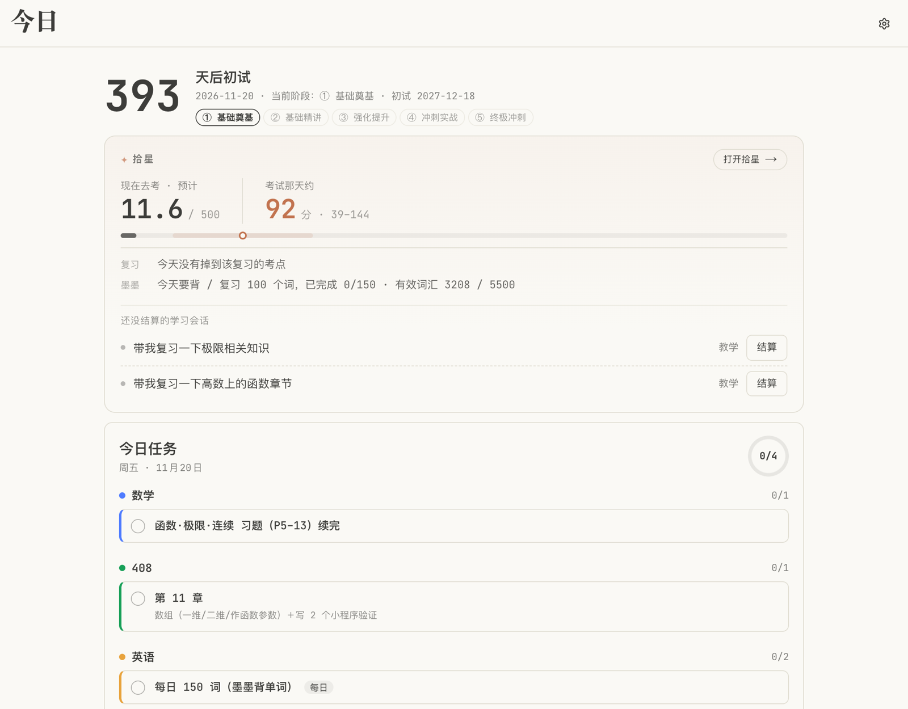
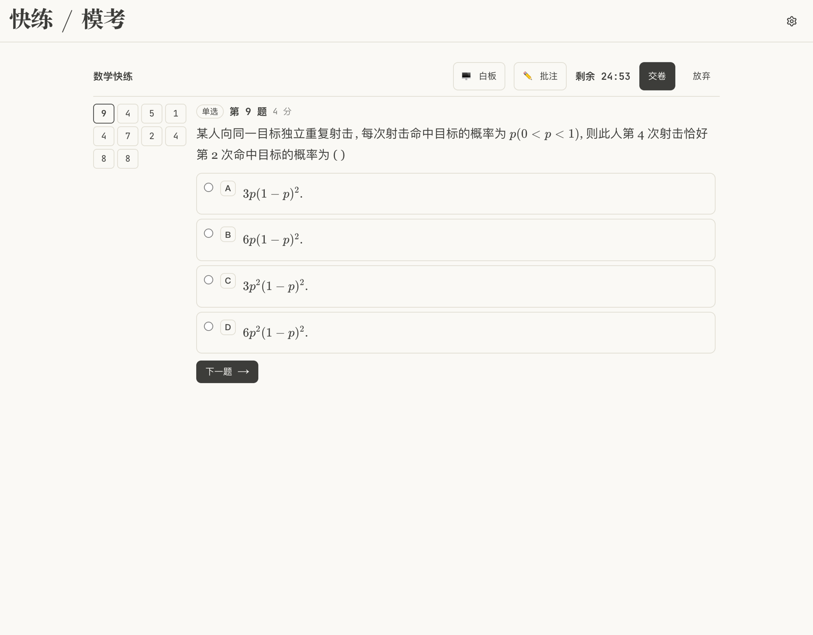
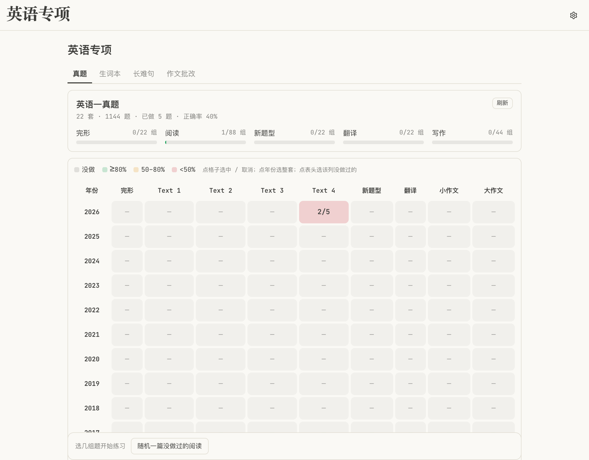
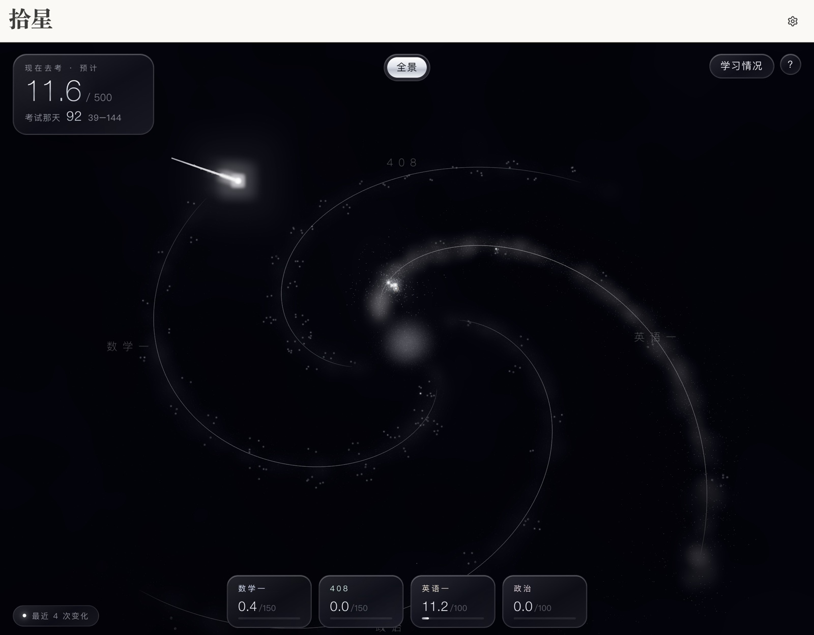
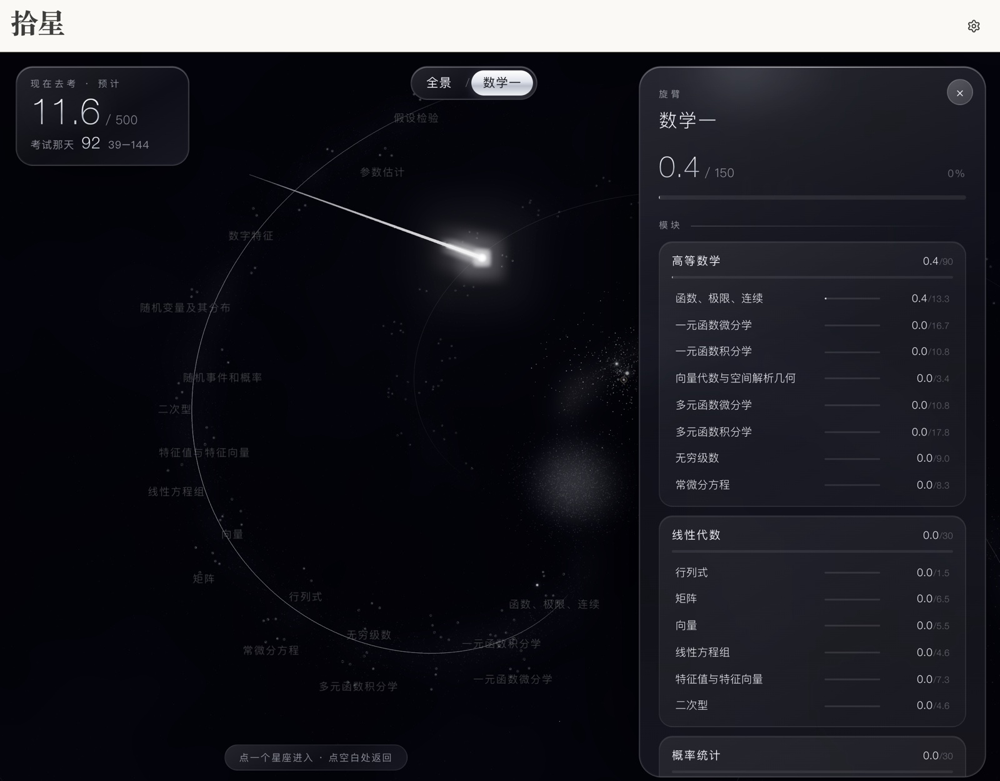
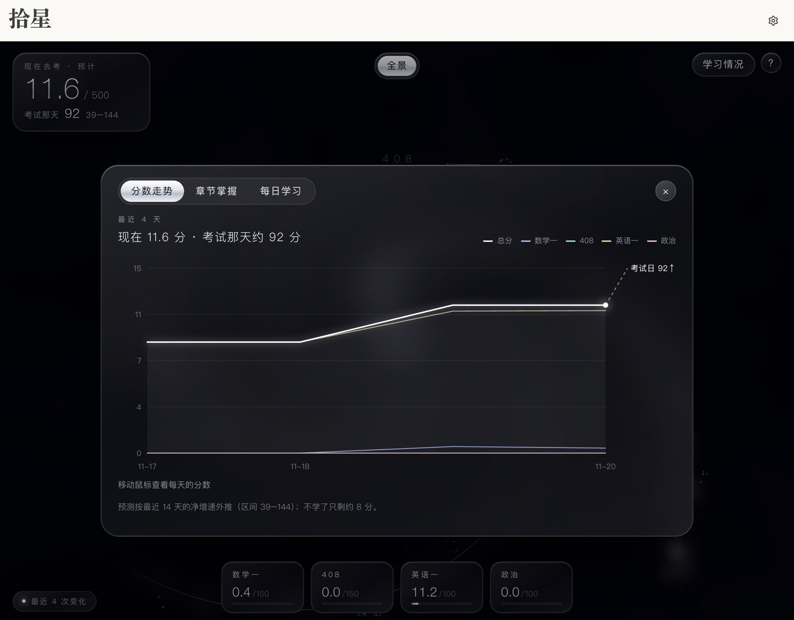

# 考研工具箱（LearnHarness 插件 `kaoyan`）

侧边栏五个页面 + 会话顶栏一个按钮 + 讲课时的 AI 工具。


| 页面 | 功能 |
| --- | --- |
| 今日 | 初试倒计时与阶段；今日任务（从 Obsidian 周计划挑出今天的：带今天日期的、「每日安排」表里今天那行对应的、每日型任务；勾选写回 md，带 ✅ 日期；每日型任务的勾选只记在插件数据里）；到期错题 / 生词；按科目的学习时长（今天、本周、近 7 天柱状图，会话科目可手动改） |
| 错题本 | 今日重做（FSRS 排期，AI 判分或自评，再来/困难/良好/简单）；全部错题（按科目、错因、来源筛选，归档、编辑）；讲题记录（拍照讲题的批改表）；学习模式问题清单；录入（拍照识别纸质书错题 / 手动，AI 分析错因） |
| 题库 | **完成情况**：数学一 / 408 按「年份 × 题型」的格子图显示每道真题做没做、对没对（快练模考、会话里用真题出的题、错题重做都算），可按考点筛选，选题后直接开练；按试卷浏览、改答案与考点；缺解析的题让 AI 按标准答案补写、连答案都没有的题让 AI 独立解题写答案和解析（都标「非官方」，导入官方答案 / 解析后自动替换）；带图的题让 AI 在原卷页面上定位插图并用系统自带 sips 裁出来，直接显示在题干里（每题可重新裁）；导入 PDF（文字层或 OCR）、照片、粘贴文字，答案解析可单独导入合并 |
| 快练 / 模考 | 选择题小套、单科分题型（阅读按整篇抽）、整套全真模考（限时、题号导航、主观题在画板手写、「新窗口手写」（在系统浏览器打开白板，可拖到 iPad 随航屏上写，提交后自动回到练习页）或拍照作答，交卷时先 OCR 再判分；「批注」开关可以用笔直接在题目上画线）；成绩单，错题自动进错题本；题不够可让 AI 按真题风格补题 |
| 英语专项 | **真题**：英语一 2005–2026 年份 × 部分（完形 / Text 1–4 / 新题型 / 翻译 / 小作文 / 大作文）总览和完成度；点格子选组、选年份整套、选列，或只勾其中几题；按部分限时（超时变红继续计时，各组用时分开记）；文章 / 题目分栏（竖屏时文章钉在上方，点空号跳到对应题），选中单词加生词本，翻译作文可打字或手写；交卷后判分 + AI 复盘：错因（干扰项类型、用时）、逐题讲解、方法课、本文重点词勾选入生词本、强化训练（没做过的同类真题 + AI 针对错因出的题）、复制开场白去讲课会话；黄皮书解析与全文翻译。导入：`<真题文件夹>/英语一/manifest.json`（真题文件夹在设置里填），每步结果缓存在 `data/eng-cache/`。另有生词本（只做记录：加进来的词自动推送到墨墨背单词的学习计划，在墨墨里背）、长难句拆解批改、作文批改 |

### 截图

**今日**：倒计时与阶段、分数概览、待结算会话、从周计划挑出的今日任务



| 错题本 · 今日重做（内嵌手写板） | 题库 · 完成情况（年份 × 题型） |
| --- | --- |
|  |  |
| **快练 / 模考 · 答题中**（题号导航、计时、白板、批注） | **英语专项 · 真题**（年份 × 部分，颜色＝正确率） |
|  |  |

**会话里：**
- 讲题模式：在讲课 / 练习会话里直接发做完的试卷或题目照片（或以 `【讲题】` 开头），跳过测底；老师自己解题判卷、按步骤给分、定位错因知识点，调用 `kaoyan_log_paper` 记下整份批改（错题自动进错题本，原题图在后台用视觉模型定位 + sips 从照片里裁出），然后逐题讲错题、按错因知识点结合 Obsidian 笔记巩固，最后结算。学习者纠正判卷时按题号覆盖，改判为对会从错题本删掉。
- 学习模式：首句以 `【学习】` 开头的讲课会话跳过测底、先讲后考，答错用 `kaoyan_log_mistake` 记错题，讲完综合小测并用 `kaoyan_study_report` 生成问题清单，这一轮结束后弹窗询问是否导出到 Obsidian。
- 顶栏（窄窗口在「…」菜单里）「导出到 Obsidian」：原子笔记 → `concepts/<科目>/<课程>/`，普通笔记 → `笔记/<科目>/<课程>/<主题>/`，可改文件夹、名字、内容；同名文件会先询问是否覆盖。
- 讲课 / 练习 AI 可用 `kaoyan_vault_search` / `kaoyan_vault_read` 检索你的 Obsidian 笔记，用 `kaoyan_bank_search` / `kaoyan_bank_get` 检索真题题库（规划时看考法；每个知识点用真题难度的题收尾——考点都在已学范围内用原题，有超纲部分就改编或换题；作答前不透露答案），学习者作答后用 `kaoyan_bank_record` 记进完成情况。规则里还要求检查题达到考研难度（换条件、设陷阱、组合考查），与宿主「一步一题」的出题规则冲突时以插件为准。

## 拾星（分数判断机）

侧边栏「拾星」（分数判断机）：按考点估算现在去考能拿多少分（满分 500），并预测考试那天的分数。3D 螺旋星系（Three.js，打包在 `dist/assets/vendor/`）：四条旋臂各是一科，旋臂上的星座是章节，星是考点（亮度＝掌握程度，大小＝分值，琥珀色光环＝该复习；远处是保底像素的星点，近处是自发光球体加日冕，参考 Gaia Sky 等天文软件的分级做法）。背景星分给各章节，跟着章节掌握度变亮；模块达到 60% / 80% / 100% 时那一片天空放一圈光波；右上角「?」里可以预览全部点亮时的星空。「学习情况」里有分数走势、章节掌握对比、每日学习热力图。点空白处返回上一层，名字平时很淡、鼠标移上去才显示分数。

| 全景（没学的部分是暗的） | 科目旋臂 + 章节分数面板 |
| --- | --- |
|  |  |



- 考点分值：模块按考试大纲比例，模块内按题库历年真题实际考到的分数统计（近年权重高）。「怎么算的」里可以用 AI 把真题逐题归到考点，更准。
- 掌握度（按题加分）：每做完一道题（题库题、会话里逐题记录的题、错题重做、讲题批改），就按这道题的难度给对应考点的星加分。
  - 难度分 5 档，每档有掌握度上限：基础 30% · 简单 50% · 中档 70% · 较难 85% · 压轴 100%。
  - 做对一题，掌握度向这一档的上限靠近一截。所以刚开始简单题也能加分；分越高，简单题加得越少，要更难的题才能继续涨，各档都做对过才能满。
  - 做错一题，往下一档的上限回落一截：简单题做错扣得多；计算失误、审题错误扣分减半。
  - 同一道题 3 天内重做只算 0.3 倍；只听讲解按基础档算；考点分值越大，每题加得越少。
  - 难度来源：会话里由出题的 AI 逐题判断（`kaoyan_record_question` / `kaoyan_log_mistake` / `kaoyan_bank_record` / `kaoyan_log_paper` 都带 difficulty）；题库题用「?」→「AI 评定难度」批量评，没评过的按题型和位置估。
  - 星的特写面板里有「难度阶梯」，显示每档的进度和下一步该做哪一档的题。
- 遗忘：每个考点有记忆稳定度，不复习会慢慢掉（最多掉到 60%）；记忆降到 85% 以下会出现在今日面板的「该复习了」。
- 会话结算：AI 在会话收尾时自动调用 `kaoyan_settle_study`，会话顶栏也有「结算本次学习」按钮；同一会话再结算会覆盖，不会重复加分。今日面板会列出还没结算的会话。
- 单词：在 设置 → 考研工具箱 填墨墨背单词开放 API token。英语一里划出 15 分作为词汇：考研词表（5044 词，来自 [KyleBing/english-vocabulary](https://github.com/KyleBing/english-vocabulary)，BSD-3-Clause）按历年英语一真题原文里的出现次数固定分成核心高频 / 常考 / 偶见 / 大纲其余四颗星，越高频分值越高；每颗星的掌握度＝这一批词里每个词在墨墨里还记得的概率（初中基础词默认按已掌握计）。

## 考研版宿主提示词（出题和教学规则）

LearnHarness 自带的教学方法是「从最底层的道理一步步推导」，出题偏向找理解漏洞，不太贴近考研。在 设置 → 考研工具箱 → **应用考研版宿主提示词**，会用宿主自带的提示词覆盖功能替换下面 9 段（文件在 `dist/server/hostprompts/`，不改 app 本身，宿主更新也不会被覆盖；原来的覆盖文件和开关会先备份，点「恢复原版」原样还原）：

- 总纲（system-prompt）：理解 + 考场得分，只在考试会考的内容里找薄弱点
- 出题工具：选择题模式下计算 / 填空 / 解答题怎么出（结果选项、拆关键一步），一次一题不停顿
- 测底：只测高频考点，优先用真题；答错当场讲正确答案和错因
- 教学方法：考纲定义 → 讲清为什么 → 落到题型
- 规划：学习会话按「定义 → 高频题型」排，复习会话按「分值 ×（1 − 掌握度）」排节点
- 讲课：答错时讲正确答案、为什么错、一步一行的解法、一句话规律
- 预测题：只在学新方法前用，复习会话和学习模式不用
- 检查题：每道题都要有真题或习题原型，不出逻辑辨析、ε 证明、竞赛风格的偏题
- 练习：按分值选题，两轮提示不行就完整讲解

这几段提示词部分改编自 LearnHarness 自带的提示词（AGPL-3.0），按同样的许可发布，见 `dist/server/hostprompts/NOTICE.md`。

插件还给智能体提供 `kaoyan_exam_focus`（考点频率表：近 15 年题数和分值、常见题型、掌握度、最近真题），规划和测底前先查。题库检索结果标「没做过 / 做过 n 次·上次对错 / 本会话用过」，没做过和做错过的排前面，本会话取过的排最后（长会话压缩后模型也不会重复出题）。宿主更新了这几段的原版内容时，设置页会提示。

## 安装 / 更新

```sh
sh install.sh
```

首次：设置 → 社区插件 → 刷新 → 启用「考研工具箱」，然后重启 LearnHarness。改代码后重新运行 `install.sh` 并重启。数据在 `plugins/kaoyan/data/`（错题、题库、生词、记录、图片），更新时保留。

## 连接 Obsidian（给新用户）

设置 → 考研工具箱：

1. **Obsidian 考研仓库路径**：填仓库根目录（含 `.obsidian` 的那层），支持 `~/…`；也可以点「自动检测 Obsidian 仓库」，从 Obsidian 自己的仓库列表里一键选。点「测试连接」确认能读到笔记。
2. **真题文件夹（可选）**：放 `manifest.json` 的文件夹，题库「批量导入」和英语专项导入用（英语一放在子文件夹 `英语一/`）。不用就留空。
3. 保存。路径不存在会拒绝保存。

懒得手填：点「AI 自动配置连接」，复制弹出的提示词给 Claude Code 等能读写本机文件的 agent。提示词是固定文本（`dist/server/setupprompt.cjs`），不含任何本机信息；agent 会先问使用者考哪些科目（对应到插件的 数学 / 408 / 英语 / 政治），再在目标电脑上找到或新建仓库和真题文件夹，按统一格式建好目录和 manifest.json（已有文件不覆盖，不建计划），再只改设置文件里的 `vaultPath` / `papersPath`。

插件只读写这个仓库里的 md：`计划/`（周计划，今日面板读取、勾选写回）、`concepts/<科目>/…`（原子笔记）、`笔记/<科目>/…`（普通笔记），没有的文件夹导出时自动创建。

## 整理真题（给 agent 的提示词）

题库 → 导入 →「批量导入整理好的真题」里点「AI 整理真题」，复制提示词给 Claude Code 等 agent：它会先问考哪些科目、原始 PDF 在哪、整理到哪，再把 PDF **复制**改名成插件要求的目录结构并生成 `manifest.json`（原文件不动），最后列出各科缺哪些年份。提示词在 `dist/server/setupprompt.cjs`（`PAPERS_PROMPT`，目录格式与「AI 自动配置连接」共用 `PAPERS_FORMAT`）。

## 题库包（免识别分享）

题库 → 导入 →「题库包」：
- **导出**：展开「把我的题库导出成题库包」，选科目，点「导出题库包」，在 下载 里生成 `考研题库包-YYYYMMDD-HHMM.zip`（题目、答案、解析、插图、英语单元信息；不含错题、作答记录、生词、设置）。
- **导入**：把 zip 放进 下载 / 桌面 / 文稿，点「找找题库包」一键选中（或直接填路径，解压后的文件夹也行），点「导入」。同一套试卷同一题号已有的题会跳过，不覆盖。
- zip 读写是纯 Node 实现（`dist/server/pack.cjs`），macOS / Windows 通用，不需要识别、不花模型额度。

## 模型

普通任务用「强」槽，生词释义用「便宜」槽，照片 / OCR / 拍照作答用「视觉」槽（设置 → 模型）；裁插图优先用目录里的 qwen3-vl-plus（定位准），没有就用「视觉」槽。扫描版 PDF 用系统自带 PDFKit 渲染成图片（首次使用会用 Xcode 命令行工具编译一个小工具，约几秒）。

## 代码结构

- `dist/backend.cjs` 入口：设置、错题、组卷判分、智能体规则与工具。
- `dist/server/`：`vault`（Obsidian 读写）、`notes`（会话→笔记）、`bank`（题库导入/组卷/判分）、`english`、`engimport`（英语一真题导入）、`engpractice`（英语真题总览 / 复盘 / 强化题）、`progress`（数学 / 408 真题完成情况）、`padserver`（本机白板网页，LearnHarness 禁止弹窗所以走系统浏览器）、`stats`（时长/今日）、`fsrs`、`llm`、`pdf`、`jobs`、`syllabus`（考点关键词，用于给会话归科目）、`scoreframe`（分数框架：科目→模块→章节→考点及分值）、`score`（掌握度 / 遗忘 / 预测 / 会话结算）、`momo`（墨墨背单词开放 API）。
- `dist/main.js` + `dist/assets/*.js`：各页面与导出弹窗；`assets/sky3d.js` + `assets/sky/scene.js` 是 3D 分数星空，`assets/score.js` 是结算浮窗和成绩单里的分数影响。
